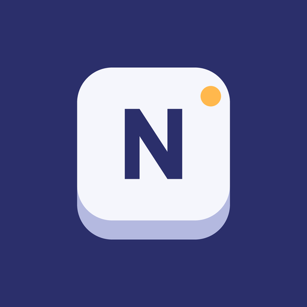

# Numen

<p align="center">
  
</p>

A keyboard app for the Unihertz Titan 2 Elite, tuned for typing in English. It keeps the
keyboard bar out of the way while you type and fixes more of your typos.

Numen is a fork of [Pastiera](https://github.com/palsoftware/pastiera) 0.86 by Andrea Palumbo,
Patrick Zauner and contributors. It is not an official Pastiera release.

## What's different

- **Hidden bar.** Nothing pops up while you type on the keys. Press SYM to show the bar.
- **Stronger autocorrect**, on by default. Fixes missing, extra and swapped letters, wrong
  neighbouring keys, missed spaces and badly mangled long words ("instalaltion" → "installation"),
  and picks the fix that fits the words before it ("pick up some kilk" → "milk"). Knows common
  misspellings ("arguement" → "argument") and fixes slips on names you've typed in the
  conversation. Leaves names, slang, contractions, email addresses and links alone.
- **Sentence-aware fixes**, on by default. Catches real words in the wrong place ("get dome food"
  → "get some food", "wagged it's tail" → "wagged its tail", "ill check" → "I'll check").
- **Undo.** Backspace right after a correction undoes it. A word you undo and keep twice is
  learned.
- **Typing stats** on the home screen: words, typos fixed, speed and favourite word.
- **Simpler settings** and a short setup.

The extra autocorrect is English only. Other languages work as they do in Pastiera, after you
download their dictionary in Settings. Numen is only tested on the Titan 2 Elite.

## Compared with Pastiera

Both apps typed the same 19,500 words of everyday messages, with a typo in 12% of words
(`ChatSimulationTest`). Pastiera's automatic correction was switched on; it's off by default.

| | Pastiera 0.86 | Numen 1.0.1 |
|---|---|---|
| Typos fixed | 24% | 76% |
| Correct words changed by mistake | 1 in 160 | 1 in 4,600 |
| Missed letters fixed ("helo") | 3 of 366 | 284 of 361 |
| Extra letters fixed ("helllo") | 0 of 400 | 368 of 399 |
| Missed spaces fixed ("seeyou") | 0 of 130 | 111 of 130 |

## Install

1. Download `Numen-x.y.z.apk` from [Releases](https://github.com/jlo-aug/numen/releases) and
   open it on your phone.
2. Open Numen, tap **Turn on**, then choose Numen as your keyboard.

Numen has its own app ID (`app.numen.keyboard`), so it installs alongside Pastiera. It doesn't
check for updates itself; [Obtainium](https://github.com/ImranR98/Obtainium) can watch this repo
and install new releases.

## Privacy

- No analytics, accounts or update checks.
- Typing stats and learned words stay on the phone. They're left out of Android backups and
  phone-to-phone transfers.
- Numen only goes online when you download a dictionary or layout from Pastiera's repository.
- Permissions: internet, microphone (voice input), Bluetooth (Clicks keyboard cases), vibration,
  wake lock, and display over other apps (a trackpad debug overlay).

## Build

Requires JDK 21 and the Android SDK.

```bash
./gradlew :app:testNightlyDebugUnitTest   # tests, typo benchmark and chat simulation
./gradlew :app:assembleNightlyRelease      # release APK
```

Numen is the `nightly` flavor. Release signing reads `PASTIERA_NIGHTLY_KEYSTORE_PATH`,
`PASTIERA_NIGHTLY_KEYSTORE_PASSWORD`, `PASTIERA_NIGHTLY_KEY_ALIAS` and
`PASTIERA_NIGHTLY_KEY_PASSWORD`. After merging Pastiera changes, run
`python3 tools/numen_branding.py` to regenerate Numen's strings. The scripts that build and
evaluate the autocorrect data are in `tools/`.

## The name

In ancient Rome, a numen was a small spirit that protected the places people loved. The little
character you meet on first launch is the numen of your keyboard.

## Credits and licences

- Numen and Pastiera are licensed under the [GNU GPL v3](LICENSE).
- Pastiera: created by Andrea Palumbo (PalSoftware, [Ko-fi](https://ko-fi.com/palsoftware)),
  developed by Patrick Zauner and Andrea Palumbo, with the contributors listed in the app's About
  screen.
- Word data: Simple English Wikipedia (CC BY-SA 4.0), Tatoeba (CC BY 2.0 FR), Google Books Ngram
  2-grams via orgtre/google-books-ngram-frequency (CC BY 3.0), SCOWL (Kevin Atkinson), Wikipedia's
  lists of common misspellings (CC BY-SA 4.0) and US Social Security Administration baby names
  (public domain). See [THIRD_PARTY_NOTICES.md](THIRD_PARTY_NOTICES.md).
